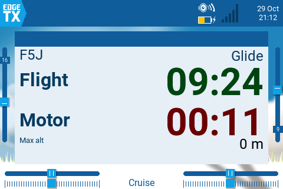
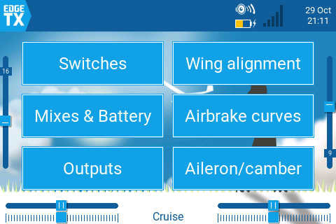
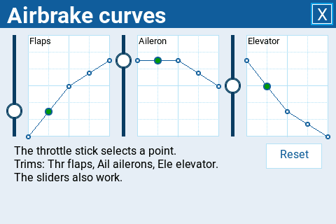

# SoarF5J EdgeTX

`SoarF5J` is an F5J package for EdgeTX landscape color radios. A single widget
covers the whole workflow:

- **Competition** - the F5J contest flow, from launch and motor run through
  glide timing, finish, and zero result.
- **Model setup** - a full in-radio setup UI for switches, outputs, wing
  alignment, brake curves, camber, mixes, and motor idle, so a model can be
  configured from the radio screen without a PC or Companion.

The widget runs from the radio SD card. The active model template supplies the
flight modes, timers, logical switches, global variables, curves, mixes, and
named outputs that the widget reads or edits.

  

**Guide (PDF):** an M-tail model step by step, from the SD card to the first flight, in
[English](docs/guides/SoarF5J-MTail-en.pdf), [Russian](docs/guides/SoarF5J-MTail-ru.pdf), and [Bulgarian](docs/guides/SoarF5J-MTail-bg.pdf).

## Pages

`Page` is the only widget option; it selects the competition page or one of the
seven setup pages.

| Page | Purpose |
| --- | --- |
| `1` | Competition: launch, motor, glide, finish, zero result, working-window voice, motor timer, and F5J start-height capture from `Alt+`. |
| `2` | Switches: assign physical switch positions to the model's logical switches. |
| `3` | Mixes: edit the mix global variables for the selected flight mode. |
| `4` | Outputs: reorder named outputs, reverse direction, and set offset, range, center, and endpoints. |
| `5` | Wing alignment: align the four flaperon outputs with the trims and on-screen sliders. |
| `6` | Brake curves: edit the airbrake flap and aileron curves and the elevator compensation along the brake travel, with the trims. |
| `7` | Aileron/camber: adjust aileron travel, aileron-to-flap, camber-to-aileron, and thermal camber with the trims. |
| `8` | Motor: set the motor idle at minimum throttle with the throttle trim while the motor runs. |

Pages `2..8` are the setup UI and write model changes immediately. Disconnect
the motor before output, wing, brake, or camber setup; only the Motor page
needs it connected. A setup page takes keys and taps only in full screen:
long-press its tile and choose `Full screen`. EdgeTX keys, trims, and touch
gestures then drive the controls, with no save button. See [widget setup and
usage](docs/widget-setup-and-usage.md#setup-pages) for the full workflow.

## What To Configure

| Area | Configure | Details |
| --- | --- | --- |
| Template | Pick the correct tail template and wire outputs. | [model templates](docs/model-templates.md) |
| SD card | Install the official EdgeTX 2.12 SD card, then add the widget, templates, and sound prompts. | [SD-card structure](docs/sdcard-structure.md) |
| Widget | Add `SoarF5J` and choose `Page`. | [widget setup and usage](docs/widget-setup-and-usage.md) |
| Switches | Assign launch, motor, landing, voice, vario, and flight-mode switches on `Page = 2`. | [control assignments](docs/model-templates.md#current-control-assignments) |
| Model setup | Tune outputs, wing alignment, brake curves, camber, mixes, and battery warning on `Page = 3..7`. | [setup pages](docs/widget-setup-and-usage.md#setup-pages) |
| Simulator | Test layout and setup pages before using the radio. | [emulator workflow](docs/emulator.md) |

## Build And Verify

```sh
make package
make verify
```

`dist/SDCARD` is not a complete SD card and has no EdgeTX voice pack. On a
radio, install the official EdgeTX 2.12 SD-card content and a voice pack first,
then copy only `WIDGETS/SoarF5J`, `TEMPLATES/3.SoarEdgeTx`, and the `.wav`
files in `SOUNDS/en`; see [SD-card structure](docs/sdcard-structure.md). Later
widget-only updates can use:

```sh
make install-widget SDCARD=/Volumes/TX15
```

The Companion simulator can use `dist/SDCARD` itself as its SD Structure path.
More docs: [project structure](docs/project-structure.md) and [TX15 artifact notes](models/tx15/README.md).
